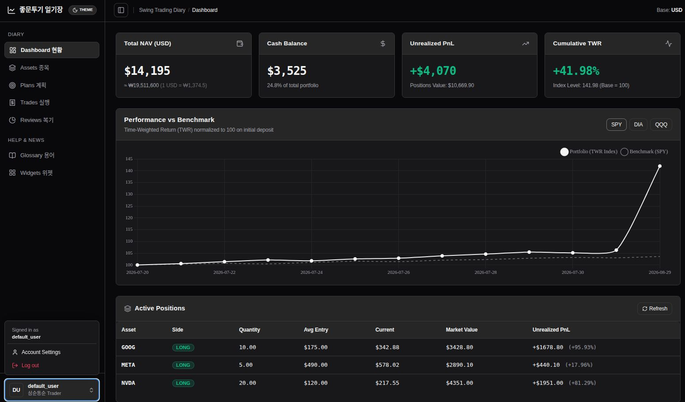

# Mini Trading Diary

A lightweight, self-hosted swing trading journal and portfolio tracking system.  
Built with a zero-build, no-Node architecture using FastAPI, SQLite, HTMX, and Alpine.js.



---
## Future Roadmap (확장 계획)
1. **Table Import and Export Function**: CSV/Excel/JSON 형태의 자산, 계획, 체결 원장 대량 업로드 및 백업 다운로드 기능
2. **Market Data Refinement**: 외부 시장 데이터 파이프라인(`data_market.py`) 고도화, 벤치마크 수익률 분포(Return Distribution in time window) 및 변동성/MDD 정밀 산출
3. **Multi-tenancy**: 선제 배치된 `user_id` 아키텍처 기반 다중 사용자 인증(Auth), 세션 격리 및 사용자별 포트폴리오 관리

---

## Features

- **Pre-Trade Planning**: Define entry, stop loss, take profit, position size, and confidence score before entering trades. Auto-calculates Risk-to-Reward Ratio (RRR).
- **Execution Ledger**: Track spot, futures, and options executions along with cash deposits/withdrawals.
- **TWR Benchmark Comparison**: Calculates Time-Weighted Return (TWR) and compares your performance against market benchmarks (SPY, QQQ, DIA).
- **Confidence vs Performance Analytics**: Analyze whether high-confidence setups actually yield higher win rates and realized PnL.
- **Interactive DataGrid**: Column visibility toggles, multi-attribute filtering, grouping, and instant sorting without heavy client-side frameworks.
- **Zero-Build Stack**: Runs directly on Python with CDN-delivered assets. No npm, webpack, or frontend compilation required.

---

## Tech Stack

| Layer        | Technology                                                 |
| ------------ | ---------------------------------------------------------- |
| **Backend**  | Python 3.13, FastAPI, Uvicorn, Pydantic v2                 |
| **Database** | SQLite 3 (WAL mode enabled)                                |
| **Frontend** | Jinja2 templates, HTMX, Alpine.js, Tailwind CSS (Play CDN) |
| **Charts**   | Chart.js                                                   |
| **Design**   | Shadcn-inspired dark theme UI                              |

---

## Quick Start (Docker)

The simplest way to run the application is with Docker Compose.

```bash
# Clone the repository
git clone https://github.com/primenumbersam/app-trade-diary.git
cd app-trade-diary

# Run container
docker compose up -d
```

Open `http://localhost:8000` in your browser.

Database is stored at `./data/diary.db` and persisted via volume mount.

---

## Local Development (Without Docker)

```bash
# 1. Create and activate virtual environment
python3 -m venv .venv
source .venv/bin/activate

# 2. Install dependencies
pip install -r requirements.txt

# 3. (Optional) Seed mock data
python app/seed.py

# 4. Start development server
uvicorn app.main:app --reload --port 8000
```

---

## Remote Access (Cloudflare Tunnel)

To access your diary securely from anywhere without opening firewall ports, pair it with Cloudflare Tunnel:

1. Install `cloudflared` on your host.
2. Route your domain to the local container:
   ```bash
   cloudflared tunnel run --url http://localhost:8000 <YOUR_TUNNEL_NAME>
   ```

---

## Project Structure

```text
├── app/
│   ├── database.py         # SQLite connection & schema initialization
│   ├── main.py             # FastAPI entrypoint
│   ├── seed.py             # Mock data generator
│   ├── models/             # Pydantic validation schemas
│   ├── routers/            # Page routes & API endpoints
│   ├── services/           # PnL & TWR calculation engines
│   ├── static/             # CSS & client scripts
│   └── templates/          # Jinja2 HTML templates
├── data/                   # SQLite database directory (volume mounted)
├── docker-compose.yml
├── Dockerfile
└── requirements.txt
```

---

## License

MIT
